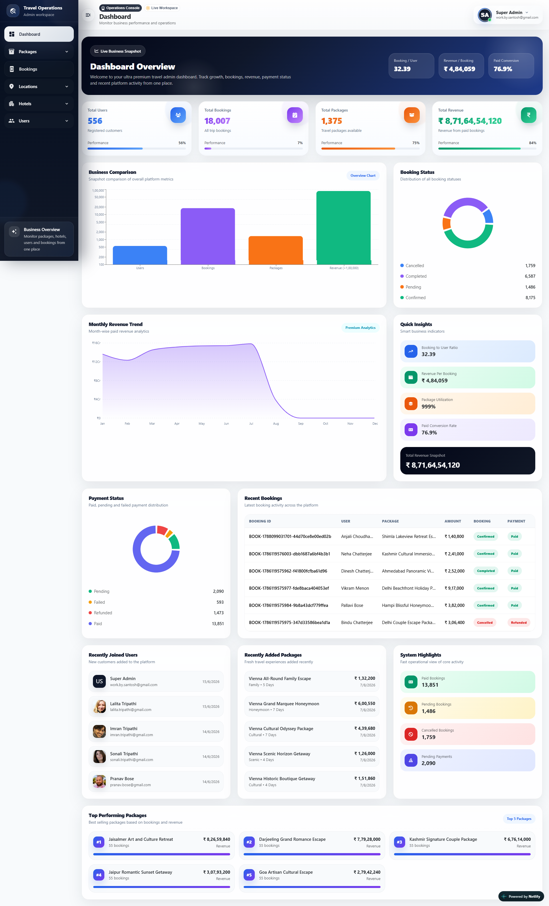
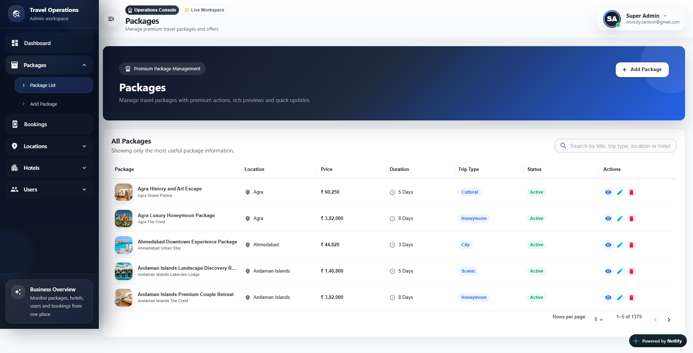
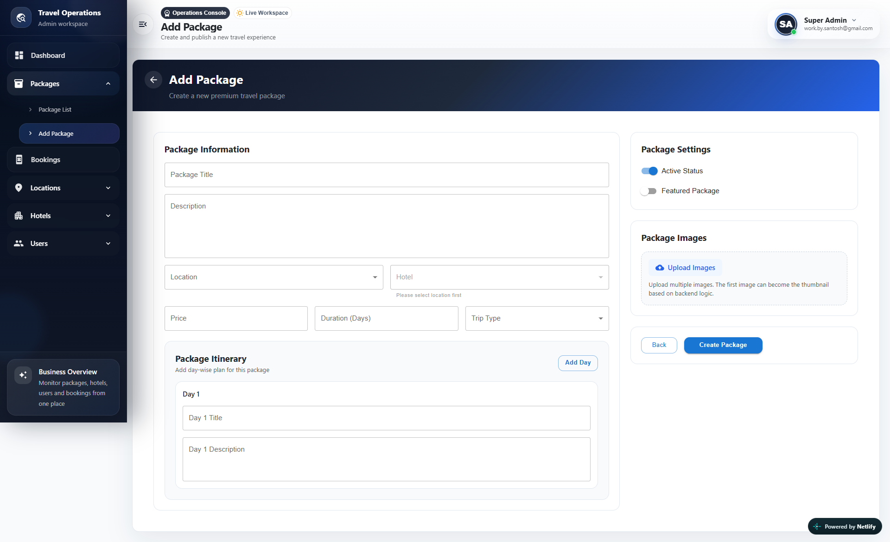
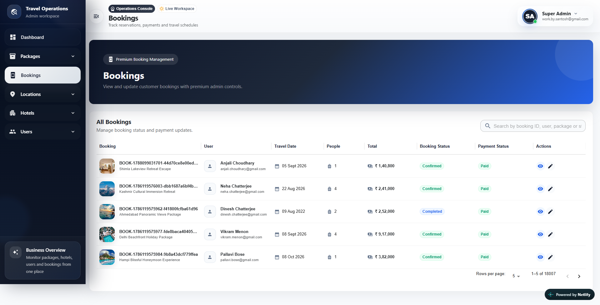
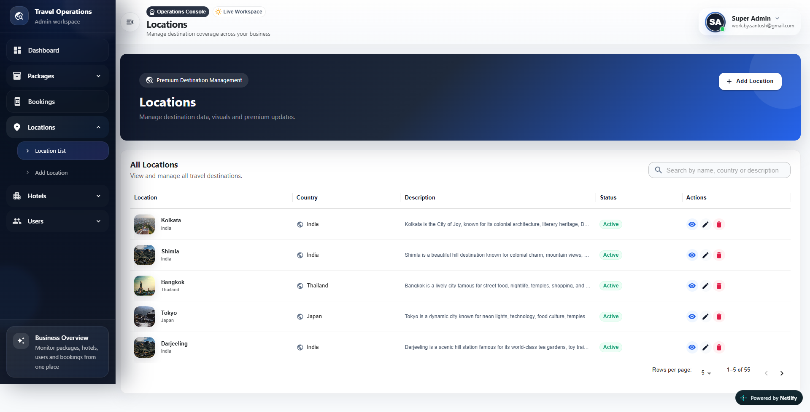
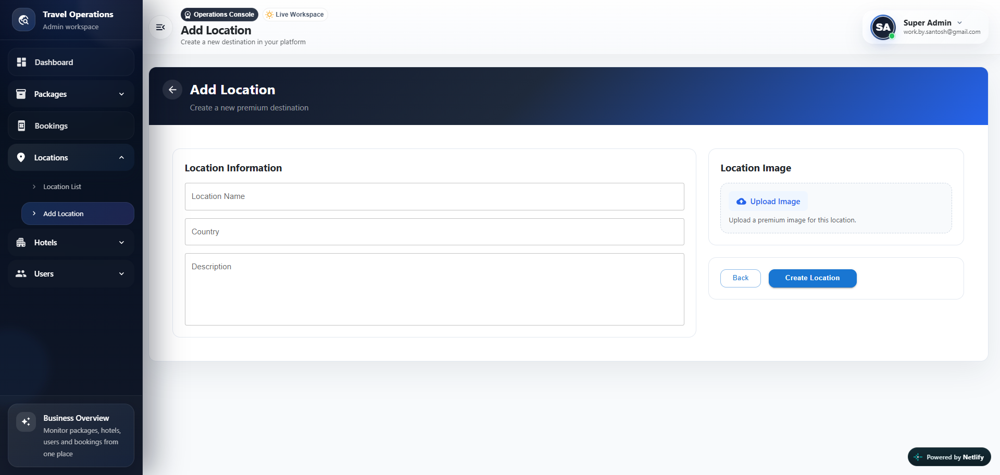
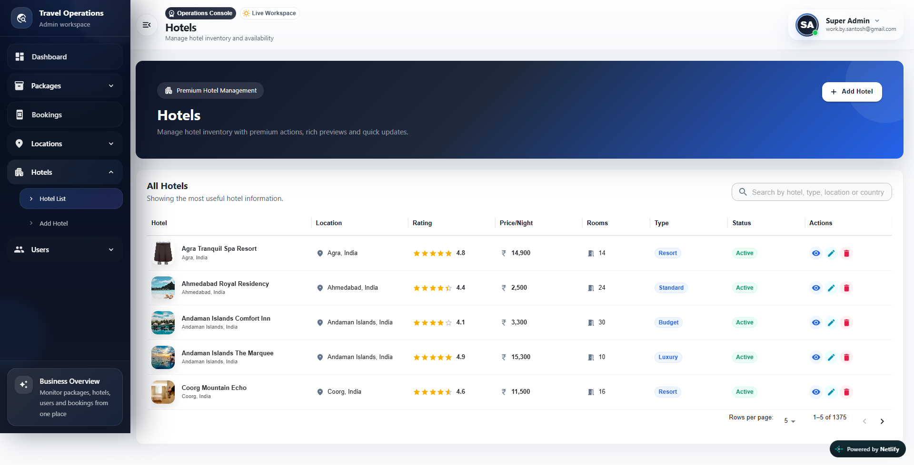
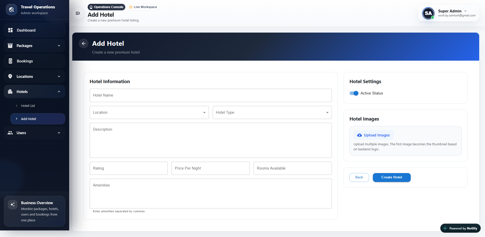
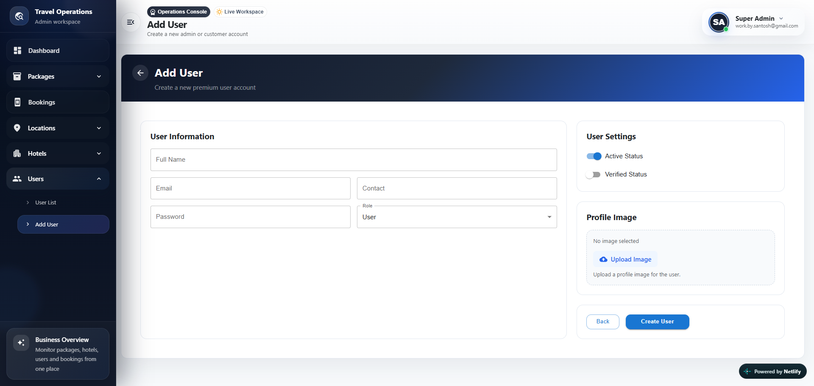

# MERN Travel Agency

A full-stack travel booking platform built with MongoDB, Express, React (Next.js), and Node.js, plus a dedicated admin dashboard.
Browse destinations, hotels, and packages, book trips with secure Razorpay payments, manage wishlists, and track bookings — all backed by a JWT-authenticated REST API with Cloudinary image uploads.

Live Link: [View Here](https://mern-travel-agency-santosh.vercel.app/)

Screenshots:

